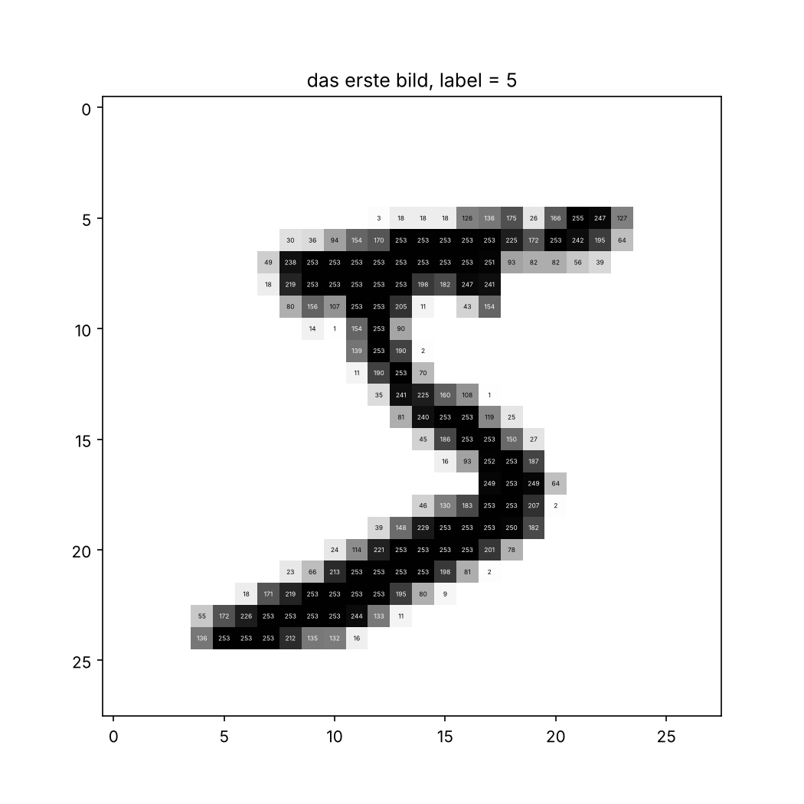
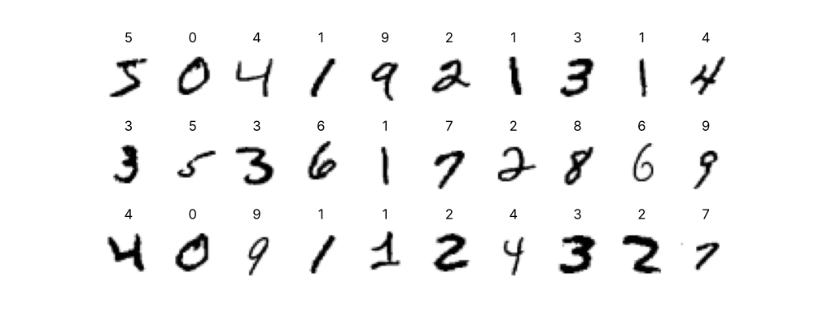
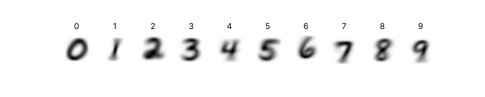
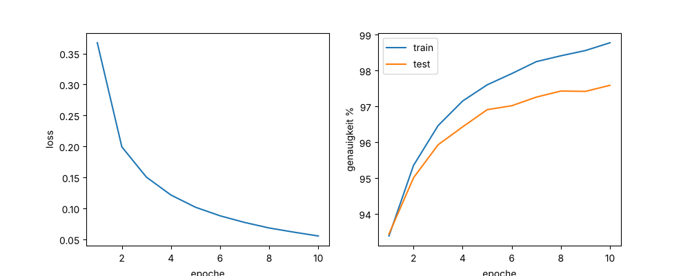
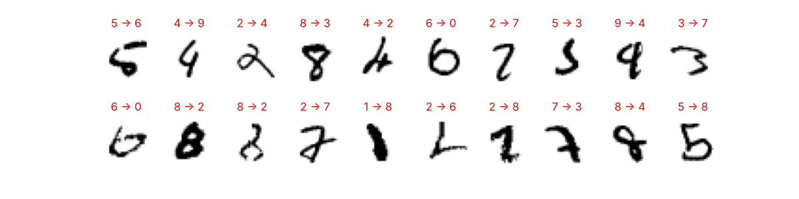
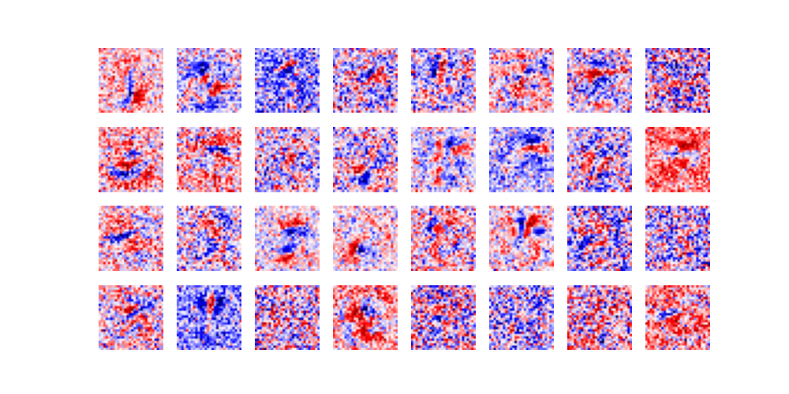

# digits-ml-project

Ich bin Informatik Student an der TU-Berlin und wollte neben den Vorlesungen mal was mit Machine Learning ausprobieren. Ich hatte vorher davon ehrlich gesagt keine Ahnung, ich kannte nur die 3Blue1Brown Videos über neuronale Netze. Also hab ich mir das klassische Anfängerprojekt genommen: dem Computer beibringen, handgeschriebene Zahlen zu erkennen.

Ich wollte das ohne TensorFlow oder PyTorch machen, nur mit numpy, damit ich auch verstehe was da eigentlich passiert. Der Code ist deswegen sicher nicht der schönste, aber er funktioniert :D

## Der Datensatz

Ich benutze MNIST. Das sind 60000 Trainingsbilder und 10000 Testbilder von handgeschriebenen Zahlen 0 bis 9. Jedes Bild ist 28x28 Pixel groß und jeder Pixel ist eine Zahl zwischen 0 (weiß) und 255 (schwarz).



Das fand ich am Anfang am wichtigsten zu verstehen: für den Computer ist ein Bild einfach nur eine Tabelle mit Zahlen. Wenn man die 28 Zeilen hintereinander schreibt hat man eine Liste mit 784 Zahlen und damit kann man dann rechnen.



## Was ich gemacht hab

Ich hab das in mehreren Schritten gemacht, jede Datei ist ein Schritt. Ich hab nicht direkt mit dem neuronalen Netz angefangen, sondern erst mal einfachere Sachen ausprobiert.

### 1. Daten anschauen (01_pixel_anschauen.py)

Bilder laden, ausgeben, im Terminal als ## und .. anzeigen und schauen ob jede Zahl ungefähr gleich oft vorkommt (tut sie).

### 2. Durchschnittsbild (02_durchschnitt.py)

Meine erste eigene Idee: ich nehme alle Bilder von einer Zahl und rechne den Durchschnitt aus. Dann kommt sowas raus:



Für ein neues Bild schaue ich dann welchem Durchschnittsbild es am ähnlichsten ist (also wo die Differenz der Pixel am kleinsten ist). Das hat schon 82% geschafft, was ich für so eine einfache Idee echt krass fand.

### 3. k-nearest-neighbors (03_knn.py)

Statt mit dem Durchschnitt vergleiche ich ein Bild mit allen Trainingsbildern und schaue welche 3 am ähnlichsten sind. Die Zahl die am öftesten vorkommt ist dann der Tipp. Das ging auf 91.9%, ist aber sehr langsam, deswegen hab ich nur 10000 Trainingsbilder und 1000 Testbilder genommen (dauert trotzdem ca. 20 Sekunden).

### 4. Neuronales Netz (04_neuronales_netz.py)

Das eigentliche Projekt. Das Netz hat 3 Schichten:

- 784 Eingaben (die Pixel)
- 128 Neuronen in der Mitte mit ReLU
- 10 Ausgaben, eine pro Zahl, mit Softmax

Trainiert wird mit Gradient Descent in Batches von 64 Bildern, Lernrate 0.1, 10 Epochen. Das Schwierigste war die Backpropagation, also wie man ausrechnet in welche Richtung man jedes Gewicht ändern muss. Da hab ich ziemlich lang gebraucht und viel auf Papier gerechnet. Die Ableitungen sind am Ende eigentlich nur Kettenregel aus Analysis 1, aber mit Matrizen.

Ergebnis nach 10 Epochen: 97.59% auf den Testdaten, also nur 241 von 10000 Bildern falsch. Das Training dauert ca. 15 Sekunden.



Das hier sind ein paar Bilder die falsch erkannt wurden (richtige Zahl -> Tipp vom Netz). Manche würde ich selbst auch nicht richtig lesen.



Man kann sich auch die Gewichte von den Neuronen als Bild anschauen. Rot heißt der Pixel zählt positiv, blau negativ. Ich hatte gehofft man sieht da schöne Striche und Kreise, aber es ist eher Rauschen mit ein bisschen Struktur.



### 5. Eigene Zahlen (05_eigene_zahl.py)

Hier kann man ein eigenes Bild (schwarz auf weiß) erkennen lassen. Das Bild wird umgedreht, zugeschnitten, auf 20x20 verkleinert und in die Mitte von einem 28x28 Bild gesetzt, weil die MNIST Bilder auch so gemacht sind.

```
eigene/drei.png -> 3 (100.0% sicher)
eigene/eins.png -> 1 (99.4% sicher)
eigene/sieben.png -> 3 (77.7% sicher)
```

Die 7 erkennt es noch nicht, siehe notizen.md.

## Zusammenfassung

| Methode | Genauigkeit |
|---|---|
| Durchschnittsbild | 82.03% |
| kNN (k=3) | 91.9% |
| Neuronales Netz | 97.59% |

## Ausführen

```
pip install -r requirements.txt
python 01_pixel_anschauen.py
python 02_durchschnitt.py
python 03_knn.py
python 04_neuronales_netz.py
python 05_eigene_zahl.py eigene/drei.png
```

Die Daten werden beim ersten Mal automatisch in den Ordner data/ geladen.

## Was ich noch ergänzen will in kommenden updates

- rausfinden warum meine 7 nicht erkannt wird
- ein CNN ausprobieren (da soll man über 99% kommen)
- eine kleine Website wo man selbst eine Zahl malen kann
